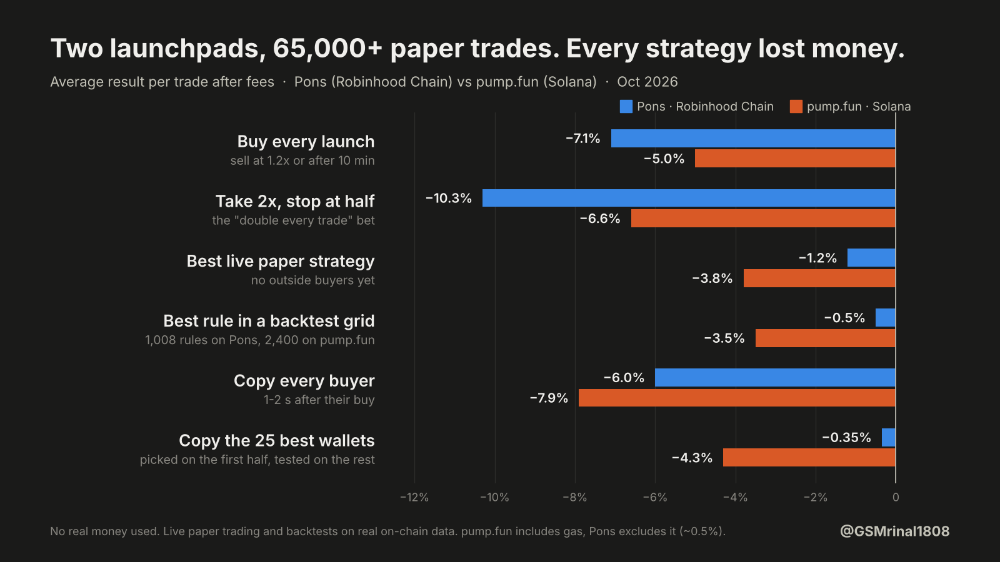

# pons-research

Can a home bot make money sniping new memecoins on a bonding-curve launchpad?

I wanted a bot that buys new tokens and doubles its money. Before risking a
cent, I recorded every launch and every trade on two launchpads, rebuilt the
curve math from that data, backtested thousands of rules and ran the best ones
live as paper trades:

- **Pons** on Robinhood Chain, Oct 8-12 2026
- **pump.fun** on Solana, Oct 13-14 2026 (21.6 hours)

**Short answer: no, on either chain.** After fees, every approach lost money on
average. The best ones only got close to zero, and only on Pons.

| | Pons | pump.fun |
|---|---|---|
| launches recorded | 6,584 | 17,753 |
| curve trades recorded | 240,000+ | 1,740,000+ |
| live paper trades | 6,767 + 105 | 58,348 |
| rules backtested | 1,008 | 2,400 |
| rules profitable in both halves | 0 | 0 |
| copied buys in the wallet test | ~70,000 | 404,855 |



No wallet, no keys, no transactions. Every script only reads public chain data.

---

## Part 1: Pons on Robinhood Chain


### 1. The curve is an exact constant-product curve

A launch starts from virtual reserves of **1.68 ETH and 1,000,000,000
tokens**, and every trade moves along `x * y = k`.

- Fitting the dev's first buy on 4,502 launches gives **R² = 1.0000**.
- Replaying reserves through 97,470 later buys predicts the tokens out with
  **0.00% median and 0.00% 90th-percentile error**.

Each launch event carries a 4.2 ETH graduation target. Once the curve has
taken in that much, the token moves to a Uniswap v4 pool. That caps the price
on the curve at (5.88 / 1.68)² ≈ **12.25x the launch price**. The biggest
runners in the data peaked at 10.4x to 12.1x and then graduated. A 100x can
only happen after graduation.

### 2. Fees: 1% to the platform, plus a creator fee fixed per token

Every buy and every sell pays a flat 1%, plus a second fee. The second fee
never changes within a token (true for all 2,677 tokens with 3+ trades), so
it is visible from the first trade.

| second fee | share of tokens |
|---|---|
| 0% | 14% |
| 1% | 14% |
| 2% | 42% |
| 3% | 11% |
| 10% | 2% |

A round trip therefore costs between ~2% and ~21% before slippage and gas.
The 10% tokens averaged **-25% per trade** in paper trading.

### 3. Most tokens die within minutes

From the first 20 hours (1,427 tokens at least 2 hours old):

| | share |
|---|---|
| got even one buyer besides the dev | 65% |
| got 5+ outside buyers | 29% |
| still trading after 1 hour | 25% |
| ever reached 2x the launch price | 9.9% |
| ever reached 10x | 0.4% |
| graduated | 0.6% |

The median token's last trade came **4.5 minutes** after launch. Over the
full four days about 1% of tokens graduated.

### 4. After graduation it is a lottery with a bad average

Graduated tokens swing wildly from day to day. On one day, every token
whose graduation price I had was between 0.06x and 0.8x of it. The next
day, during a market-wide pump, a few were 5x to 15x up. By the last
snapshot, more than 20 of the 68 graduated tokens sat at 0.05x to 0.09x.

`hold_test.py` asked the plain question: put $1 into every token the first
time it reaches N times its launch price, and hold.

| entry | tokens | $1 became |
|---|---|---|
| 2x launch price (~$8.6k market cap) | 334 | $0.76 |
| 5x launch price (~$21k) | 85 | $0.62 |

### What was tested on Pons

All results are per trade, after the 1% fee, the token's own fee, and
slippage on both sides. Gas (~0.5% of a 0.002 ETH trade) is not included.

| approach | data | result per trade |
|---|---|---|
| Buy every launch 5 s in, sell after 10 min | 3,019 tokens, backtest | -7.1% |
| "2x before half": enter at 2 min, take 2x, stop at -50% | 3,271 tokens, backtest | -10.3% |
| 1,008 entry / filter / exit combinations | 43 hours, backtest | 0 profitable in both halves; best ≈ -0.5% |
| 6 exit strategies, live | 6,767 live paper trades | -3.5% to -5.3% |
| Best filter: creator fee ≤ 1%, no outside buyers yet, 1.2x or 10 min | backtest, period it was *not* found on (297 trades) | +0.3% to +1.3% |
| same rule, live at exact curve prices | 105 live paper trades | -1.2% (95% range -5.8 to +3.7) |
| Copy every buyer 2 s later | 39,042 copied buys | -6.0% |
| Copy the 25 best wallets (picked on the first half of the data) | 316 tokens, second half | -0.35% (95% range -3.1 to +2.4) |

**Speed was not the problem.** The live bot saw new launches about 0.5 to
0.9 seconds after they were mined.

**The one partial signal was wallets.** Copying the best wallets did 3 to 6
points better than copying everyone, so wallet choice carried some
information. It still did not beat the fees. Six of the first half's top 10
wallets lost money in the second half (one fell from +13% to -21%), which
looks more like luck than skill.

---

## Part 2: pump.fun on Solana

Pump.fun is the biggest launchpad on Solana, so this was the real test of
whether the Pons result was just a small, quiet market.

### How it was measured

- **One websocket** subscribed to every transaction that touches the pump.fun
  program, on the free public Solana RPC.
- **Events decoded with the official IDL** (`pump-fun/pump-public-docs`).
  Every trade event carries the curve's reserves after the trade and the
  fee rates charged, so prices come straight from the chain. On normal
  coins `x * y = k` held on **100%** of trades (2,652 of 2,652 and 2,450 of
  2,450 in two checks), and every trade started where the previous one
  ended.
- **Mayhem coins were left out.** On them a pump.fun program trades without
  fees, and its trades do not follow the curve (`x * y = k` held on 41-45%
  of their trades), so their prices could not be trusted. Coins paired with
  USDC or other pump coins were left out too.
- **Costs:** 0.95% protocol + 0.30% creator fee on each side for nearly
  every coin, our own price impact, gas of 0.0002 SOL per transaction
  (0.8% of a 0.05 SOL round trip), and an order that lands 0.5 to 2 s after
  the bot sees the event.
- **The rules were fixed before any Solana data came in**, with a pass bar
  of +3% per trade in both halves of the data. The market-cap rules at the
  end came later, from ideas traders use, and face the same bar.

### What the market looks like

- 21 to 32 new coins a minute and 52 to 64 curve trades a second in daytime
  samples. Over the run the bot recorded 17,753 launches and 1.74 million
  curve trades (the first two hours of each coin).
- 61% to 71% of the transactions that touch the program **fail**. They are
  bots competing for the same blocks, and a third or more of the data.
- In one-minute samples, outside wallets bought **in the launch block
  itself** in 19% to 52% of launches. The bot saw events about 1.3 s after
  their block.
- Most coins go nowhere: 75% of the "buy every launch" positions ended at
  the 10-minute limit without moving 20% either way. The median trade lost
  3.6%, which is exactly the cost of a round trip.

### What was tested on pump.fun

All results are per trade, after both fees on both sides, price impact, the
order delay and gas.

| approach | data | result per trade |
|---|---|---|
| Buy every launch, order lands 0.5 s / 2 s after seeing it, sell at 1.2x / -50% / 10 min | 17,069 / 17,057 live paper trades | -5.0% / -6.0% |
| No outside buyers 5 s in (the best Pons filter), 1.2x / 10 min | 6,223 live paper trades | -3.8% |
| Momentum: 10+ outside buyers in the first minute, 1.3x / 10 min | 1,282 live paper trades | -9.7% |
| "2x before half": enter 5 s in, take 2x, stop at -50%, 60 min | 11,238 live paper trades | -6.6% |
| 2,400 entry / filter / exit combinations | 15,253 coins, backtest | 0 above zero in both halves; best -3.5% |
| Copy every buyer 1 s later | 208,597 copied buys | -7.9% |
| Copy the 25 best wallets (picked on the first half) | 120 coins, second half | -4.3% (95% range -11.1 to +2.4) |
| Buy at $8k market cap, sell at $25k, stop at -50%, max 60 min | 1,513 trades, backtest | -19.1% |
| Buy at launch, sell at 2x, stop at -50%, max 10 min | 10,899 trades, backtest | -10.4% |

None of them made money. The backtest replays the live paper trader to the
trade: both give 14,960 trades at -5.10% for "buy every launch", so the two
can be trusted to agree.

### Why it does not work here either

- **The fees are bigger than the moves.** A round trip costs about 3.6%,
  and most coins never move that much.
- **The snipers are already in.** Buying a coin that had already run 1.5x
  before our order landed lost 9% to 16% per trade. Faster orders helped a
  little (0.5 s beat 2 s by about one point), but the money is in the
  launch block, not 1 s later.
- **Good wallets do not stay good.** Seven of the first half's ten best
  wallets made no copyable trades at all in the second half; the three that
  did made -11.5%, +2.6% and +6.9% per copied coin. The list was also full
  of duplicates: three "different" wallets had the same 10 coins, the same
  timing and the same +28.5%, which looks like one trader with several
  wallets. Picking wallets did carry some information, as on Pons: the best
  50 wallets lost 2.0% per copy against 7.9% for copying everyone. It still
  lost money. Selling when they sell was worse (-11.2% for every buy): they
  sell first, and the copy sells into their exit.

### Market-cap targets

Two rules traders actually use, tested on the same data with
`sol_mc_test.py`. With SOL at $107 a coin launches at about $2,992 market
cap.

| rule | trades | result per trade |
|---|---|---|
| Buy at $8k market cap, sell at $25k, stop at -50%, max 60 min | 1,513 | -19.1% |
| Buy at launch, sell at 2x, stop at -50%, max 10 min | 10,899 | -10.4% |
| The same with a 20% slippage limit (orders that would land 20%+ above the price the bot saw fail and cost only gas) | 7,161 | -6.3% |
| Best of 400 launch combinations: sell at $4.5k or after 1 minute, with the slippage limit | 7,161 | -3.3% |

How often each target was reached when buying at launch (stop at -50%, max
10 min):

| target | reached | needed to break even |
|---|---|---|
| 2x | 7.7% | 16.0% |
| 1.5x | 14.3% | 25.6% |
| $7k market cap | 17.6% | 35.4% |
| $6k | 23.2% | 43.8% |
| $4.5k | 38.4% | 68.5% |

- **Every target was reached about half as often as it needed to be.** A
  2x win made +105%, but a miss lost 20% on average, so one win paid for
  five misses and came with twelve.
- **"Buying at launch" is not buying at the launch price.** The median order
  landed at $3,504, 17% above it; a quarter landed 57% or more above, a
  tenth 103% or more. When the coin dies it falls back toward $3k, and that
  gap is the loss.
- **Getting there eventually is not getting there before the stop.** 31.5% of the coins
  that reached $8k went on to $25k, but only 17.6% of the trades got there
  before the -50% stop or the hour ran out (27.5% needed). A miss lost 53%
  on average. Coins whose dev had already sold did worst (-29.7%).

---

## Why neither worked

A bonding curve is close to zero-sum between traders. An early buyer only
profits if later buyers pay more, and on every trade the platform and the
creator take their cut. Most tokens never get later buyers. The rest of the
money goes to whoever is fastest and best informed, and a home bot reading
public data is neither.

---

## Mistakes worth keeping

Every one was caught by the data, and most had made a losing strategy look
profitable.

1. **A verdict that ranked on one half and checked only the other.** The
   first Pons backtest called rules "profitable" that had lost money in the
   half used to pick them and won in the next. That was a market swing, not
   an edge. Fix: a rule must make money in both halves.
2. **Average trade price is not the price you get.** Right after the dev's
   buy on Pons, the last trade's average price sits about 1.3% below the
   curve's real price. Every later buy then looked like a gain. Fix: fit the
   curve and price every entry and exit from its reserves.
3. **Token-paired curves priced as if they were ETH.** Some Pons launches
   pair with another token. Pricing them with the ETH formula produced
   "72x in 68 seconds" trades; 16 of them turned the baseline's -5.5% into
   a reported +5.5%. Fix: skip anything that is not paired with the native
   coin. Pump.fun has the same trap (USDC and pump-coin pairs).
4. **One snapshot is not a result.** Graduated Pons tokens were 0.06x to
   0.8x on one day and 5x to 15x the next. Any single day can tell either
   story.
5. **One malformed RPC reply killed both bots for hours.** An endpoint
   returned its error as a plain string instead of an object. Fix: treat
   every reply as untrusted, retry, and skip bad logs instead of crashing.
6. **A check that passes on average can hide a broken subset.** On
   pump.fun, `x * y = k` failed on 22% of trades. Split by coin type, it
   held on 100% of normal coins and on under half of mayhem coins. Fix:
   break every check down before trusting it.
7. **Free tiers count bytes.** The pump.fun stream is roughly 20 to 70 GB a
   day depending on the hour, so a free RPC plan's monthly credits would
   have lasted a day or two. The free public endpoint carried the run
   instead.
8. **The computer is part of the experiment.** A Windows update restarted
   the laptop in the middle of the night run. The bot logs every gap, and
   positions that lived through one are left out of the score.
9. **A few trades can look like a strategy.** Run with only one position
   open at a time, the "2x before half" rule made +22.8% over 34 trades;
   with three open, +17.4% over 104; with five, +7.3% over 150. Over all
   11,238 trades it lost 6.6%, in both halves. When only 6% of trades win,
   a short run is mostly luck.

---

## Scripts

### Pons (Robinhood Chain), top level

| script | what it does |
|---|---|
| `probe_robinhood.py` | Checks RPCs, block time and launch rate, and decodes one launch event. |
| `watcher.py` | Records every launch, curve trade and graduation to CSV. Resumes after restarts. |
| `analyze_pons.py` | Fees, funnel, peaks, the "2x before half" bet, dev-sold signal. |
| `grad_tracker.py` | Looks up graduated tokens on DexScreener; appends snapshots over time. |
| `backtest_pons.py` | Replays 1,008 rules; a rule must win in both halves; fee analysis. |
| `check_rule.py` | Fits the curve, measures the pricing artifact, re-tests the best rule. |
| `hold_test.py` | Buy at N x launch price and hold until now. |
| `paper_trader.py` | Live paper trading at exact curve prices, several strategies at once (version 3.1; the first live run priced from the last trade, see mistake 2). |
| `paper_report.py` | Scores the paper trades, including small-wallet position limits. |
| `wallet_test.py` | Picks wallets on the first half, follows them on the second. |

### pump.fun (Solana), `solana/`

| script | what it does |
|---|---|
| `probe_solana.py` | One-minute check: data rate, event decoding, `x * y = k`, fees, snipers, lag. |
| `sol_bot.py` | Records launches and trades and paper-trades 6 rules live, from one websocket. Public RPC first, a backup RPC second; logs every gap. |
| `sol_report.py` | Scores the paper trades against the pass rule set before the test. |
| `sol_backtest.py` | Replays the recorded data through 2,400 rules; first checks that it reproduces the paper trader. |
| `sol_wallet_test.py` | Picks wallets on the first half, follows them on the second. |
| `sol_mc_test.py` | Market-cap rules (buy at $X, sell at $Y or at Nx) with filters, hit rates and a slippage limit. |

## Running it

```bash
pip install requests websockets

# Pons
python probe_robinhood.py     # sanity check
python watcher.py             # leave running; collects data
python analyze_pons.py        # after a few hours
python backtest_pons.py
python check_rule.py
python hold_test.py           # needs grad_tracker.py snapshots
python wallet_test.py         # needs a few days of data
python paper_trader.py        # live paper trading
python paper_report.py paper_trades_v3.csv

# pump.fun (in solana/)
python probe_solana.py        # one-minute check
python sol_bot.py             # leave running; records and paper-trades
python sol_report.py
python sol_backtest.py
python sol_wallet_test.py
python sol_mc_test.py         # buy at $8k/$10k, sell at $25k/$30k
python sol_mc_test.py 107 3000 2x,1.5x,7000,6000,4500 10,1,5,30   # buy at launch
```

Python 3.10+. Data files (`*.csv`, `*.json`, `*.txt`) are gitignored. A backup
RPC URL for the Solana bot can go in `solana_rpc.txt` (also gitignored).

## Limits

A few days of two launchpads in one market mood. Paper trading cannot show
competition for the same block, failed transactions or MEV, and all of those
would make real results worse, not better. The tests cover rules a bot can
run on public on-chain data. They do not cover a trader with off-chain
information.

Not financial advice. The point of this repo is the opposite.
